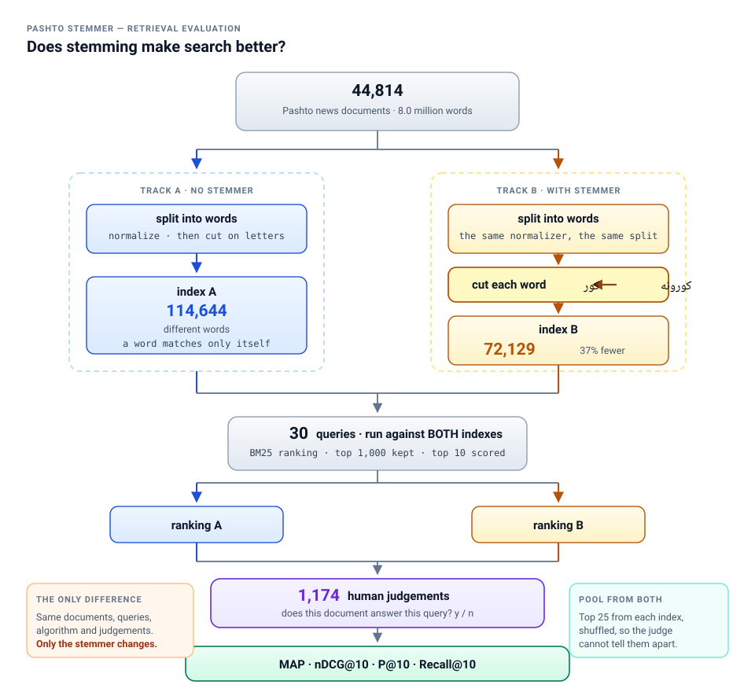
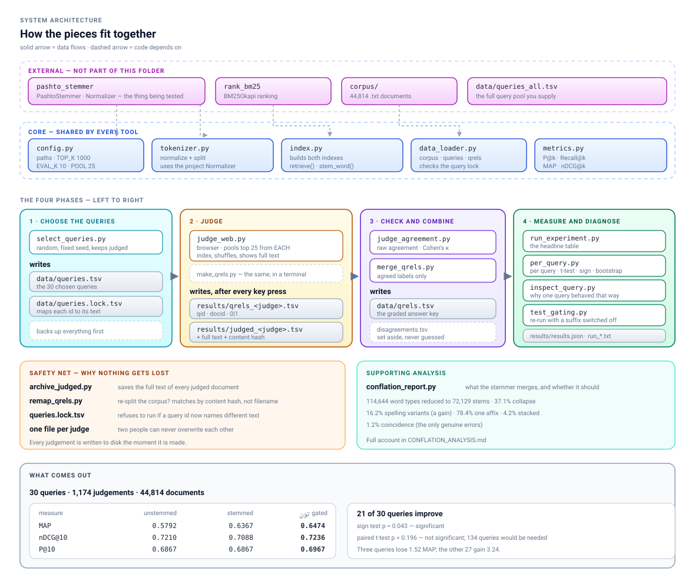

# How the retrieval test works

A test of one question: **does the Pashto stemmer make search better?**

Everything here is in `/home/khairullah/Documents/testing Folder/stemmer/IR`.

| | |
|---|---|
| corpus | 44,814 Pashto news documents, 8.0 million words |
| queries | 39 Pashto search queries |
| judgements | 1,489 human decisions: does this document answer this query |
| what is compared | the same search engine, twice: without the stemmer and with it |

---

## 1. The idea in one picture



**The only difference between the two sides is the stemmer.** Same documents,
same queries, same search algorithm, same judgements. So any difference in the
scores can only come from stemming.

---

## 2. The whole architecture

The diagram above is the *idea*. This one is the *system*: which file does
what, what it reads, what it writes, and what depends on what.



Four phases, left to right:

| phase | you run | it writes |
|---|---|---|
| **1 · choose the queries** | `select_queries.py` | `data/queries.tsv`, `data/queries.lock.tsv` |
| **2 · judge** | `judge_web.py` | `results/qrels_<judge>.tsv`, `results/judged_<judge>.tsv` |
| **3 · check and combine** | `judge_agreement.py`, `merge_qrels.py` | `data/qrels.tsv` |
| **4 · measure and diagnose** | `run_experiment.py`, `per_query.py`, `inspect_query.py`, `test_gating.py` | `results/results.json`, `run_*.txt` |

Underneath all four sits the **core**: `config.py` holds every path and
setting, `tokenizer.py` and `index.py` do the text work, `data_loader.py`
reads the files, `metrics.py` does the arithmetic. Every tool uses the same
core, which is what makes the two tracks comparable — neither arm can drift
away from the other by using a different tokenizer or a different reader.

---

## 3. The pipeline, step by step

### Step 1 — Read the documents

`data_loader.py` → `load_corpus()`

One `.txt` file per document in `corpus/`. The filename without `.txt` is the
document's id.

```
corpus/doc00000.txt  →  docid "doc00000"
corpus/doc00001.txt  →  docid "doc00001"
...
44,814 files
```

### Step 2 — Split the text into words

`tokenizer.py` → `tokenize(text)`

Two things happen, in order.

**2a. Normalize** — using the project's own `Normalizer`, the same one the
stemmer uses:

```
مُدَّت     →  مدت        remove Arabic diacritics
کـــور    →  کور        remove the stretching character
ﻛﻮﺭ       →  کور        fix Arabic presentation forms
ك         →  ک          Arabic kaf → Pashto keheh
ي ې ۍ ئ ی                all five yeh letters are KEPT as they are
زده‌کوونکي →  unchanged   the invisible joiner is KEPT
```

**2b. Cut into words** — keep runs of Arabic-script letters, digits and the
joiner. Everything else is a boundary.

```
"د کورونو خبرونه، زده‌کوونکي او مُدَّت"
      ↓
['د', 'کورونو', 'خبرونه', 'زده‌کوونکي', 'او', 'مدت']
```

Note `خبرونه` with no comma attached. Arabic punctuation (`،` `؛` `؟` `۔`)
lives in the same Unicode block as the letters, so the tokenizer matches
letters *positively* rather than splitting on everything else.

### Step 3 — Build two indexes

`index.py` → `build_unstemmed_index()` and `build_stemmed_index()`

```
UNSTEMMED                           STEMMED
doc00000: [د, کورونو, خبرونه]        doc00000: [د, کور, خبر]
doc00001: [کورونه, ښارونه]           doc00001: [کور, ښار]
...                                 ...
114,644 different words             72,173 different words
```

The stemmer collapses the vocabulary by **37%**. That is the whole point: a
search for `کورونه` can now find a document that only says `کور`.

### Step 4 — Score with BM25

`index.py` → `retrieve()`

BM25 is the standard formula for ranking documents by text. For each query
word it asks three things:

| | |
|---|---|
| **how often** does this word appear in the document? | more is better |
| **how rare** is the word in the whole corpus? | rarer is better |
| **how long** is the document? | shorter is better, for the same count |

Settings used: `k1 = 1.5`, `b = 0.75` — the standard defaults from
`rank_bm25`.

```
score(document, query) = Σ   idf(word) ×        f(word, doc) × (k1 + 1)
                       word                ─────────────────────────────────
                                           f(word, doc) + k1 × (1 − b + b × len/avg)
```

In plain terms: **a document scores high when it contains rare query words
many times and is not too long.**

The top 1,000 documents are kept; the scores are measured on the top 10.

### Step 5 — Build the pool of documents to judge

`make_qrels.py` or `judge_web.py`

A human cannot read 44,814 documents per query. So for each query we take the
top 25 from **each** index and judge the union:

```
query: روغتون درملنه

top 25 from the unstemmed index   ┐
                                  ├─→ union (about 35–49 documents)
top 25 from the stemmed index     ┘            │
                                        shuffled, so you
                                     cannot tell which index
                                      produced which document
```

**Why both indexes.** If the pool came only from the unstemmed index, any
document that only the stemmed index finds would never be shown, never judged,
and counted as irrelevant — the experiment would be scored on a pool built to
favour the competitor. Pooling from both is the standard remedy.

**Why shuffled.** So you judge the document, not the system.

### Step 6 — A human judges

`judge_web.py`, in the browser at `http://127.0.0.1:8000`

One document at a time, full text on screen:

```
┌────────────────────────────────────────────────────┐
│  روغتون درملنه                                      │
│  q110 · 326 of 509 judged · 183 left               │
├────────────────────────────────────────────────────┤
│  doc30949                                          │
│  [the complete document text]                      │
├────────────────────────────────────────────────────┤
│      [ اړوند  y ]   [ اړوند نه دی  n ]   [ skip ]   │
└────────────────────────────────────────────────────┘
```

The rule for deciding is in **`RELEVANCE_RULES.md`** — read it before judging.

Each answer is written to disk immediately:

```
results/qrels_khairullah.tsv      q110  doc30949  1
results/judged_khairullah.tsv     the same, plus the full document text
                                  and a hash of it, for later verification
```

### Step 7 — Score

`run_experiment.py` and `per_query.py`

Four measures, each computed for both indexes:

| measure | question it answers |
|---|---|
| **P@10** | of the top 10 results, how many are relevant? |
| **Recall@10** | of all relevant documents, how many are in the top 10? |
| **MAP** | are the relevant ones near the top, or scattered down the list? |
| **nDCG@10** | the same, weighting the top positions more heavily |

### Step 8 — Is the difference real?

`per_query.py`

Averages hide everything. The per-query table is the result:

```
query   rel |  MAP un  MAP st    diff
q001     35 |  0.4370  0.7901 +0.3530   better
q003     26 |  0.5824  0.1189 -0.4635   much worse
q006     34 |  0.8583  0.9691 +0.1109   better
...
mean                          +0.1110   sd 0.2353
```

Then three tests:

- **paired t-test** — is the average difference bigger than the noise?
- **sign test** — do more queries improve than worsen?
- **bootstrap** — a 95% range for the true difference

---

## 4. The scripts

| file | what it does |
|---|---|
| `config.py` | all paths and settings in one place |
| `tokenizer.py` | normalize and split into words |
| `data_loader.py` | read the corpus, queries and judgements |
| `index.py` | build both indexes, retrieve, call the stemmer |
| `metrics.py` | P@k, Recall@k, MAP, nDCG |
| `select_queries.py` | draw the query sample safely from a larger pool |
| `judge_web.py` | the browser judging tool |
| `make_qrels.py` | the terminal judging tool (same files) |
| `judge_agreement.py` | agreement and Cohen's κ between two judges |
| `merge_qrels.py` | combine judges; set disagreements aside |
| `archive_judged.py` | save the full text of every judged document |
| `remap_qrels.py` | carry judgements onto a re-split corpus |
| `run_experiment.py` | the headline table |
| `per_query.py` | per-query results and the statistical tests |
| `inspect_query.py` | diagnose one query: both rankings side by side |
| `test_gating.py` | re-run with chosen suffixes switched off |
| `conflation_report.py` | what the stemmer merges, and whether it should |

---

## 5. Running it

```bash
cd "/home/khairullah/Documents/testing Folder/stemmer/IR"
PY="/home/khairullah/Documents/Pashto Faker/.venv/bin/python"
```

Use `$PY`, not `python3` — the packages are in that virtual environment.

**Choose the queries** (keeps anything already judged):

```bash
$PY select_queries.py data/queries_all.tsv 30
```

**Judge** (about 90 seconds to start, then open the browser):

```bash
$PY judge_web.py YOUR-NAME
```

**Check agreement between two judges:**

```bash
$PY judge_agreement.py khairullah classmate
```

**Get the result:**

```bash
$PY merge_qrels.py khairullah
$PY run_experiment.py
$PY per_query.py
```

**Diagnose a query that behaved oddly:**

```bash
$PY inspect_query.py q110
```
or in the browser: `http://127.0.0.1:8000/inspect?q=q110`

---

## 6. What protects the experiment

Each of these exists because the obvious approach was wrong.

| protection | the problem it prevents |
|---|---|
| pool from **both** indexes | judging a pool built to favour one side |
| **shuffled** presentation | judging the system instead of the document |
| **full document** shown | judging on half the text and missing the answer |
| both sides share **one** tokenizer and normalizer | measuring a tokenizer difference and calling it stemming |
| **one judge name per file** | two people overwriting each other |
| **saved after every keypress** | losing hours to a closed window |
| **full text + hash archived** | judgements becoming unverifiable later |
| `queries.lock.tsv` | a query id being reused for different text, silently |
| **fixed random seed** | an unrepeatable sample |
| **per-query table**, not just averages | one odd query hiding behind a mean |

---

## 7. Current state

```
44,814 documents · 39 queries · 1,489 judgements
```

| | unstemmed | stemmed |
|---|---:|---:|
| MAP | 0.5407 | **0.6517** |
| nDCG@10 | 0.6675 | **0.7178** |
| P@10 | 0.6359 | **0.6821** |
| Recall@10 | 0.2946 | **0.3479** |

30 of 39 queries improve with stemming. The average difference is **+0.1110
MAP**, which **is** statistically significant (paired t = 2.95, p = 0.005;
sign test p = 0.001). The three cutoff-10 measures all improve too, but none
of those reaches significance on 39 queries.

Nine queries still lose, three of them heavily. For what they reveal — and for
the one suffix that was gated because of them — see **`IR_FINDINGS.md`**.
